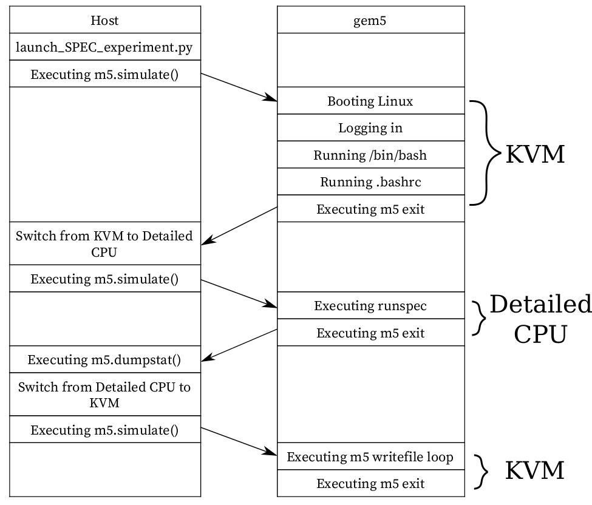

## Frontend Spec Araştırması

### yayın içinde olacaklar;
* bpu'da batch etkisini göstermek için örnek bir tablo

| m | MPKI | IP | Simülasyon hızı |
|---|---|---|---|
|1  |	5.20 |	4.50 |	1.0×|
|5  |	5.21 |	4.50 |	1.8×|
|10 |	5.22 |	4.49 |	2.6×|
|20 |	5.24 |	4.49 |	3.4×|
|100    |	5.65 |	4.31 |	5.1×|
